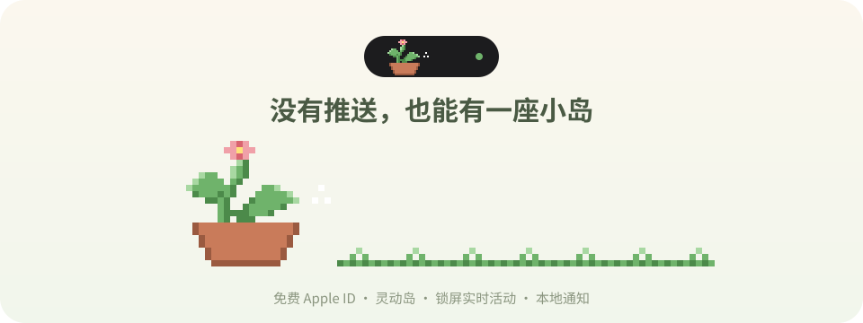

<p align="center">
  
</p>

<p align="center">
  &nbsp;
  &nbsp;
  &nbsp;
  
</p>

<p align="center">
  用免费的 Apple ID 自己装的 App，也可以有灵动岛、锁屏上的小卡片、还有像推送一样的通知。<br>
  这个仓库就是把这三样做出来的最小版本，拿去就能用，也能换成你自己的小东西。
</p>

<p align="center"></p>

## 🌱 你会得到什么

<table>
<tr>
<td align="center" width="33%"><br><b>灵动岛</b><br><sub>收起来是一个小东西和一个绿点，<br>按住展开有一句话。</sub></td>
<td align="center" width="33%"><br><b>锁屏上的小卡片</b><br><sub>正式名字叫"实时活动"。<br>不用解锁就能看见它。</sub></td>
<td align="center" width="33%"><br><b>像推送一样的通知</b><br><sub>服务器那边一有新话，<br>手机锁屏上就弹出来。</sub></td>
</tr>
</table>

这套做法在真机上跑通过（iPhone 17，用 iLoader 和一个免费的 Apple ID 装的）。不需要开发者账号，不需要付 99 美元。这个示例 App 本身目前只在 GitHub 上编译过，你装上去试的时候遇到什么，欢迎开 issue 告诉我。

## 🫧 它是怎么做到的

一般来说，这三样东西都要靠苹果的推送服务（APNs），而推送要付费的开发者账号才能开。我们没有，所以换了一条路。讲起来其实就三句话：

**1. 让 App 别睡着。**
你一离开 App，它就悄悄播放一段一秒钟的静音，循环放。手机听见"有声音在放"，就不会把它挂起。只要它醒着，就能一直问服务器"有新消息吗"。你自己在放的歌不会被打断，静音躲在底下。

**2. 小岛是系统帮我们举着的。**
锁屏小卡片和灵动岛是同一个东西，苹果叫它 Live Activity。它不要付费账号，只要 App 多带一个小扩展。我们在你离开 App 的那一下把它举起来，之后每次问完服务器就刷新一次。每次刷新都顺便说一句"五分钟后过期"。这样如果 App 真的被杀了，小岛不会假装还在线，它会变灰，告诉你"后台掉了，点开 App 看看"。

**3. 没有推送，就自己敲门。**
App 在后台问到新消息，就自己发一条本地通知。效果和推送一模一样，锁屏上弹出来、有声音、图标上有小红点。App 开着的时候不弹，同一条不会弹两次。

岛上的小画是像素格子，就是几个文本文件，`.` 是透明，字母是颜色。想换成什么都行，改文本文件，跑一下脚本。

## 🍵 先说清楚的几件事

- **只有 App 还在后台活着，这一切才成立。** 你把 App 上滑杀掉，或者手机内存紧张把它清了，消息就不会再来，小岛过五分钟会变灰。它不是推送，它只是"没睡着"。
- 后台一直放静音会**耗电**。电池设置里能看到它。这是代价，不是坏了。
- 免费 Apple ID 签的 App **7 天**过期，到期要重新装一次。每 7 天最多能签 10 个 App ID，这个 App 用掉 2 个（App 本身，加上小岛扩展）。
- 需要 iOS 16.2 以上。灵动岛要有岛的机型，没有岛的机型只有锁屏那张小卡片。
- 别的 App 开始录音或者打电话时，静音会被暂时打断，结束后会自己接上。

## 🧸 跟着做

1. **Fork 或下载这个仓库。** 打开 `project.yml`，把两个 `dev.example.islanddemo` 改成你自己的名字（随便起，比如 `com.你的名字.island`，第二个在后面加 `.island`）。
2. **让 GitHub 帮你编译。** 仓库页面点 **Actions → Build unsigned IPA → Run workflow**。等几分钟，页面底下 Artifacts 里下载 `IslandDemo-unsigned`，解压得到一个 `.ipa` 文件。GitHub 不需要你的 Apple ID，这一步是在苹果电脑上编译，你没有 Mac 也没关系。
3. **用 iLoader 装到手机。** 打开 iLoader，登录你的免费 Apple ID，把 `.ipa` 拖进去。手机上按提示打开开发者模式、信任开发者。
4. **跑一个小服务器。** 电脑上执行 `python3 server/demo_server.py`，手机和电脑连同一个 Wi-Fi。在 App 里填 `http://电脑的IP:8787`。
5. **打开"离开 App 后保持待机"，允许通知，上滑回桌面。** 几秒钟以后，岛上会出现一株小苗。
6. **在电脑上说句话试试：**

   ```bash
   curl -X POST localhost:8787/say    -d '{"text":"你好呀"}'               # 锁屏上弹通知
   curl -X POST localhost:8787/island -d '{"state":"happy","line":"开花啦"}'  # 小苗开花，岛上的话也换了
   curl -X POST localhost:8787/island -d '{"hide":true}'                   # 把小岛收起来
   ```

7. 最后试一下把 App 杀掉，等五分钟，看小岛变灰。它变灰是对的，说明它没骗你。

## 📮 服务器要怎么回话

App 只会一直问一个地址。你自己的服务器照这个格式回就行，`server/demo_server.py` 是一个几十行的例子。

```
GET /status?wait=20
    X-Presence: foreground 或 background     ← App 在前台还是后台
    X-Standby:  on 或 off                     ← 静音有没有在放

回：
{
  "island":   { "state": "happy", "line": "开花啦", "hide": false },
  "messages": [ { "id": "随便但唯一", "text": "你好呀", "title": "可以不要" } ]
}
```

有新东西就立刻回，没有就等 `wait` 秒再回当前状态。`messages` 给最近几十条就好，App 自己记得哪些弹过了。哪个字段写错了，只会丢掉那一个字段，别的照常。

## 🎨 换成你自己的小东西

- `art/palette.json` 里是字母对应的颜色。
- `art/pixels/` 里每个状态两个文件：`xxx-compact.txt` 是岛收起来时的（示例 30×21 格，一格一个点），`xxx-wide.txt` 是展开和锁屏用的（示例 90×21 格，一格两个点）。
- 画完跑 `python3 tools/make_pixel_art.py`，它会重新生成 `Shared/PixelArt.swift`。想要 README 上的图片也跟着换，再跑 `python3 tools/make_readme_art.py`。
- 加一个新状态，就是多加一对文件，服务器回 `"state": "新名字"` 就能用。
- 尺寸随你，但收起来的岛左边那块只有 36 个点那么高，别画太高。另一个 App 也有实时活动的时候，两个都会缩成小圆圈，`Island/IslandLiveActivity.swift` 里的 `minimalCrop` 决定圆圈里露出哪一块，挑你的画里最认得出的那块。

示例里的小苗是占位的，故意画得简单。换成你喜欢的。

## 🕳️ 我们踩过的坑

- **小岛在后台起不来。** 苹果只让 App 在看得见的时候启动实时活动。所以要在"离开 App 的那一下"启动，而不是等到后台再启动。那一下如果静音还没放起来，就等下一次离开。
- **小岛没几分钟就灰了。** 一开始我们只在前台刷新，后台没刷新，过期时间一到就灰。后来改成每次问完服务器都刷新一次，灰就只在真掉线时出现。
- **装好第一次打开，哗啦弹出一堆旧消息。** 现在装好以后第一次问到的消息当作旧新闻，不弹。
- **第二个 App ID。** 小岛扩展要多占一个 App ID，免费账号每 7 天 10 个，别一口气装太多别的东西。
- **杀掉 App 小岛还在。** 这是正常的，小岛是系统举着的，App 死了也不会立刻消失，只会按时变灰。想马上收掉就在锁屏上把它划走。

## 📁 仓库里都有什么

```
App/        示例 App：Standby（静音保活）、Poller（一直问服务器）、IslandController（举小岛）、
            Notices（本地通知）、PollModels（看懂服务器的话）、IslandDemoApp（界面）
Island/     小岛扩展：灵动岛和锁屏卡片长什么样
Shared/     两边共用的：小岛的数据格式、像素画（生成的）
art/        像素画的源文件和调色板
tools/      生成像素画和 README 图片的两个小脚本
server/     示例服务器，Python 标准库，不用装任何东西
Tests/      几条检查，GitHub 编译前会自动跑
docs/       README 用的图片，都是从 art/ 画出来的
```

## 🌙 来源

这些代码是从我自己一个私有的 iPhone 项目里抽出来的，去掉了那边的通话、网页和它自己的画与文案。用到的都是苹果公开的接口，没有什么魔法，只是把它们在免费签名下拼成了一套能用的，顺便把踩过的坑写下来。

MIT 协议，随便用，随便改。
